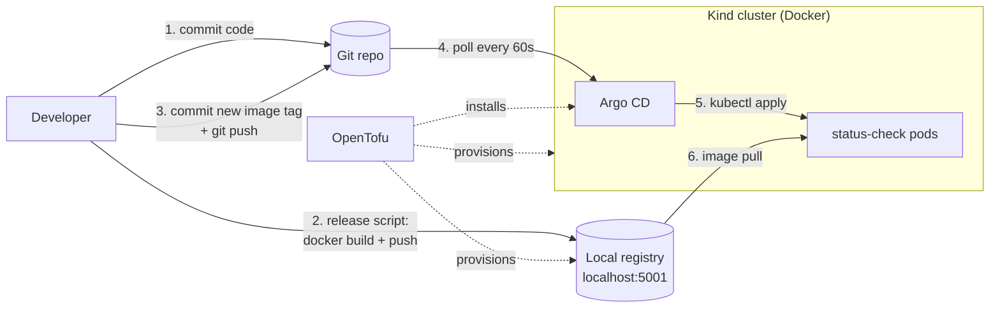

# shipfast-gitops

A GitOps deployment workflow for **status-check**, a small containerized internal status API, running on a local Kubernetes cluster.

| Tool | Role |
|---|---|
| **Docker** | Builds the app image, runs the Kind node and the local image registry |
| **Kind** | Kubernetes cluster running inside Docker |
| **OpenTofu** | Provisions the cluster, the registry, Argo CD and the Argo CD Application |
| **Argo CD** | Keeps the cluster in sync with the manifests in Git |
| Kustomize | Templates the manifests (built into `kubectl` and Argo CD) |
| GitHub Actions | Optional CI: tests, builds to GHCR and bumps the image tag |



The rule of the workflow: **you never `kubectl apply` the app yourself.** Every change to what runs in the cluster, including image versions, replica counts and check config, is a Git commit. Argo CD applies it. Rolling back means `git revert`.

---

## Contents

- [Repository layout](#repository-layout)
- [Prerequisites](#prerequisites)
- [Quick start](#quick-start)
- [Day-to-day operations](#day-to-day-operations)
- [The status-check API](#the-status-check-api)
- [How each tool is used](#how-each-tool-is-used)
- [CI with GitHub Actions (optional)](#ci-with-github-actions-optional)
- [Troubleshooting](#troubleshooting)
- [Teardown](#teardown)

## Repository layout

```
app/                          status-check service (Go, standard library only)
  main.go                     entrypoint: config, HTTP server, graceful shutdown
  internal/checks/            check types (http/tcp/dns), runner, aggregation
  internal/api/               HTTP handlers + Prometheus metrics
  Dockerfile                  multi-stage build -> distroless, non-root image
  checks.example.json         default config baked into the image
deploy/                       what Argo CD deploys (Kustomize)
  base/                       Deployment, Service, PDB, ServiceAccount, checks.json
  components/nodeport/        exposes the Service on node port 30080
  overlays/local/             image from the local registry   <- default
  overlays/ghcr/              image from GHCR, bumped by CI
infra/                        OpenTofu: Kind cluster, registry, Argo CD, Application
scripts/release.sh|.ps1       build -> push image -> commit new tag -> git push
.github/workflows/ci.yaml     test, validate, build to GHCR, bump ghcr overlay
```

## Prerequisites

| Tool | Version tested | Needed for |
|---|---|---|
| [Docker Desktop](https://docs.docker.com/get-docker/) (or Docker Engine) | 29.x | everything; must be running |
| [OpenTofu](https://opentofu.org/docs/intro/install/) | 1.13 | `infra/` (needs ≥ 1.8) |
| [kubectl](https://kubernetes.io/docs/tasks/tools/) | 1.36 | inspecting the cluster (Docker Desktop ships one) |
| git | any | GitOps |
| [kind CLI](https://kind.sigs.k8s.io/docs/user/quick-start/#installation) | optional | not required, since OpenTofu's kind provider embeds kind |
| [argocd CLI](https://argo-cd.readthedocs.io/en/stable/cli_installation/) | optional | the UI covers everything below |

You also need a **Git remote the cluster can reach**, such as GitHub or GitLab. Argo CD runs inside the cluster and clones the repo over the network, so it can't read a folder on your disk. A public repo needs no credentials. For a private repo, see `git_token` below.

Free host ports: **8080** (API), **8081** (Argo CD UI), **5001** (registry). You can change all three in `terraform.tfvars`.

## Quick start

Commands are shown for bash (Linux, macOS, Git Bash on Windows). Where PowerShell differs, it's noted.

### 1. Push this repo to a Git host

```bash
git add -A && git commit -m "initial commit"
git remote add origin https://github.com/umamidayo/shipfast-gitops
git push -u origin main
```

### 2. Provision the platform with OpenTofu

```bash
cd infra
cp terraform.tfvars.example terraform.tfvars     # then set git_repo_url
tofu init
tofu apply
```

This takes about 2–3 minutes. It creates:

1. a Kind cluster called `shipfast` (kubectl context `kind-shipfast`, merged into `~/.kube/config`)
2. a Docker registry container `shipfast-registry` on `localhost:5001`, wired into the cluster
3. Argo CD in the `argocd` namespace, with its UI on http://localhost:8081
4. an Argo CD Application `status-check` that tracks `deploy/overlays/local` on your branch

### 3. Ship the first image

The overlay starts at tag `dev`, which doesn't exist yet, so Argo CD shows the app as *Degraded* (ImagePullBackOff) until you release:

```bash
scripts/release.sh          # PowerShell: ./scripts/release.ps1
```

The script builds the image, which also runs the tests, and tags it with the current commit SHA. It pushes the image to `localhost:5001`, rewrites `newTag` in `deploy/overlays/local/kustomization.yaml`, commits that change and runs `git push`. Argo CD picks up the change within `argocd_poll_interval` (60s by default).

### 4. Check it

```bash
curl http://localhost:8080/api/v1/status
```

Argo CD UI: http://localhost:8081, user `admin`. To get the password:

```bash
kubectl --context kind-shipfast -n argocd get secret argocd-initial-admin-secret \
  -o jsonpath='{.data.password}' | base64 -d
```
```powershell
# PowerShell
$p = kubectl --context kind-shipfast -n argocd get secret argocd-initial-admin-secret -o jsonpath='{.data.password}'
[Text.Encoding]::UTF8.GetString([Convert]::FromBase64String($p))
```

## Day-to-day operations

Everything below is a Git change. Argo CD does the deploying.

### Deploy a code change

```bash
# edit app/..., then
git commit -am "api: include check target in metrics"
scripts/release.sh
```

The release script refuses to run if `app/` has uncommitted changes. The image tag is the commit SHA, so the code has to be committed for the tag to describe what's in the image.

### Change which checks run

Edit `deploy/base/checks.json`, then commit and push. **You don't need a new image.** Kustomize generates the ConfigMap with a content-hash suffix, so a config change also changes the Deployment, and Argo CD rolls the pods.

```json
{ "name": "postgres", "type": "tcp", "target": "postgres.db.svc:5432", "critical": true }
```

| Field | Required | Meaning |
|---|---|---|
| `name` | yes | unique, `[a-zA-Z0-9_.-]`, used in URLs and metric labels |
| `type` | yes | `http`, `tcp` or `dns` |
| `target` | yes | `http`: absolute URL · `tcp`: `host:port` · `dns`: hostname |
| `timeout` | no | Go duration string, default `"3s"` |
| `critical` | no | `true`: failure makes overall status `down` (HTTP 503). `false`: failure makes it `degraded` |
| `expectStatus` | no | `http` only: accepted status codes, default 200–399 (redirects are not followed) |

Invalid config (unknown fields, bad targets, duplicate names) makes the pod fail at startup with a clear log line. The rolling update stops there and the old pods keep serving.

### Scale, tune resources, change env

Edit `deploy/base/deployment.yaml` (or patch it in an overlay), then commit and push. `CHECK_INTERVAL` (default `30s`) controls how often checks run.

### Roll back

```bash
git revert <bad commit>     # e.g. the "deploy(local): status-check abc1234" commit
git push
```

Argo CD returns the cluster to the previous state. Old images stay in the registry, so rolling back an image tag is instant. For an emergency rollback in the UI, use **History and rollback**. Argo CD will warn that auto-sync overrides it, so follow it up with a revert in Git.

### Watch a deployment

```bash
kubectl --context kind-shipfast -n argocd get applications          # SYNC / HEALTH
kubectl --context kind-shipfast -n status-check get pods
kubectl --context kind-shipfast -n status-check logs deploy/status-check -f
```

To sync without waiting for the poll, click **Refresh** then **Sync** in the UI, or run:

```bash
kubectl --context kind-shipfast -n argocd annotate application status-check \
  argocd.argoproj.io/refresh=normal --overwrite
```

### What happens if someone `kubectl edit`s the app?

`selfHeal: true` makes Argo CD revert the edit within seconds, because Git is the source of truth. `prune: true` means resources you delete from Git are also deleted from the cluster.

### Change platform settings

Edit `infra/terraform.tfvars` (repo URL, branch, overlay, ports, chart versions), then run `tofu apply`. Changing the repo, branch or overlay updates only the Application. Changing ports or `node_image` recreates the cluster.

## The status-check API

A Go service with no third-party dependencies. It runs every configured check concurrently on a fixed interval and caches the results, so API calls are cheap and don't hit your dependencies on every request.

| Endpoint | Description |
|---|---|
| `GET /api/v1/status` | Aggregated report. **200** when `up`/`degraded`/`pending`, **503** when `down`, so uptime monitors can point straight at it |
| `GET /api/v1/checks` | Configured checks |
| `GET /api/v1/checks/{name}` | Latest result of one check (404 if unknown) |
| `GET /api/v1/version` | Build version (git SHA), `startedAt` and `uptimeSeconds` |
| `GET /healthz` | Liveness: the process is serving |
| `GET /readyz` | Readiness: the first round of checks has finished (503 before that) |
| `GET /metrics` | Prometheus: `status_check_up`, `status_check_latency_seconds`, `status_check_overall_up`, `status_check_build_info` |

Add `?refresh=true` to `/api/v1/status` or `/api/v1/checks/{name}` to run the checks now instead of returning cached results.

Overall status, from worst to best: **down** (a critical check failed) › **degraded** (a non-critical check failed) › **pending** (some checks haven't run yet) › **up**.

```json
{
  "version": "3f2a9c1",
  "status": "up",
  "checkedAt": "2026-10-12T04:06:57Z",
  "summary": { "total": 4, "up": 4, "down": 0, "pending": 0 },
  "checks": [
    { "name": "kubernetes-api", "type": "tcp", "target": "kubernetes.default.svc:443",
      "critical": true, "status": "up", "latencyMs": 1, "checkedAt": "2026-10-12T04:06:57Z" }
  ]
}
```

### Running it anywhere (portability)

The image is self-contained. It's a static binary on `distroless/static`, runs as non-root, works with a read-only root filesystem, and includes a default config and a Docker `HEALTHCHECK`. It runs the same way outside Kubernetes:

```bash
docker build -t status-check app
docker run --rm -p 8080:8080 status-check                      # built-in example checks
docker run --rm -p 8080:8080 \
  -v "$PWD/my-checks.json:/etc/status-check/checks.json:ro" status-check
```

| Env var | Default | |
|---|---|---|
| `LISTEN_ADDR` | `:8080` | |
| `CHECKS_FILE` | `/etc/status-check/checks.json` | |
| `CHECK_INTERVAL` | `30s` | Go duration |

Logs are JSON on stdout. To run the tests without Go installed, run `docker build app`, which runs `go vet` and `go test` as part of the build. With Go 1.24+ installed: `cd app && go test ./...`.

## How each tool is used

### Docker

- **Builds the app.** `app/Dockerfile` is a multi-stage build. A `golang` stage compiles the binary and runs the tests, so a failing test means no image. A `distroless` stage ships only the binary and default config. The resulting image is a few MB, has no shell, and runs as UID 65532.
- **Hosts the cluster.** Each Kind "node" is a Docker container (`shipfast-control-plane`) running containerd and the kubelet.
- **Hosts the registry.** `shipfast-registry` (`registry:2`) runs on Docker's `kind` network. You push to `localhost:5001` from your machine. Inside the node, containerd is told (via `/etc/containerd/certs.d/localhost:5001/hosts.toml`) that `localhost:5001` actually means `http://shipfast-registry:5000`. That's why the manifests can use `localhost:5001/status-check:<tag>`, the same name you push.

### Kind

Kind runs a real, conformant Kubernetes cluster inside Docker. It's cheap to create and throw away, which suits a reproducible local platform. You don't call `kind` yourself: OpenTofu's `tehcyx/kind` provider embeds it. The cluster config (`infra/main.tf`) does three things:

- maps node ports to `127.0.0.1` on your machine: `30080 → 8080` for the API, `30081 → 8081` for Argo CD
- patches containerd to read per-registry config from `/etc/containerd/certs.d`
- pins the Kubernetes version if you set `node_image`

### OpenTofu

OpenTofu is the single entry point for the platform. `tofu apply` creates everything and `tofu destroy` removes it. Three providers do the work:

| File | Provider | Creates |
|---|---|---|
| `main.tf` | `tehcyx/kind` | the cluster; its endpoint and certs configure the Helm provider |
| `registry.tf` | `kreuzwerker/docker` | the registry image and container, attached to the `kind` network |
| `registry.tf` | built-in `terraform_data` | runs `docker exec` on the node to write containerd's `hosts.toml` |
| `argocd.tf` | `hashicorp/helm` | Argo CD (`argo-cd` chart) and the Application (`argocd-apps` chart) |

Design notes:

- The Application is created through the `argocd-apps` Helm chart, not `kubernetes_manifest`. `kubernetes_manifest` needs the Application CRD to exist at plan time, which breaks the first `tofu apply` on an empty cluster.
- OpenTofu manages the platform. Argo CD manages the app. OpenTofu never touches `deploy/`, and Argo CD never touches the cluster or itself. That split is what makes the app's deployments purely Git-driven.
- State is stored locally in `infra/terraform.tfstate` (git-ignored), which is fine for a single-developer local cluster. For a shared or remote cluster, add a `backend` block (S3, GCS, HTTP, …).
- `.terraform.lock.hcl` is committed, with hashes for Windows, Linux and macOS. Refresh it after bumping provider versions:
  `tofu providers lock -platform=windows_amd64 -platform=linux_amd64 -platform=darwin_arm64 -platform=darwin_amd64`

### Argo CD

Argo CD is the GitOps controller. The `status-check` Application says: keep namespace `status-check` on this cluster equal to `kustomize build deploy/overlays/local` at `main`.

- **Pull-based.** Argo CD polls Git every `argocd_poll_interval`. Nothing outside the cluster needs cluster credentials, including CI and your laptop's kubeconfig.
- **Automated sync** with `prune` and `selfHeal`. New commits are applied, resources removed from Git are deleted, and manual drift is reverted.
- `CreateNamespace=true` creates the target namespace. Failed syncs retry with backoff, up to 5 times.
- It's installed with Dex and notifications disabled, and the UI is served over plain HTTP on a NodePort bound to localhost only.

### Kustomize

Kustomize is built into both `kubectl` and Argo CD, so it needs no extra install.

- `base/` holds environment-agnostic manifests plus `checks.json`. A `configMapGenerator` turns `checks.json` into a hash-suffixed ConfigMap.
- `components/nodeport` is a reusable patch that switches the Service to NodePort 30080.
- `overlays/*` choose an image registry/tag via `images:`. That one `newTag:` line is what a deployment changes.

Preview what Argo CD will apply: `kubectl kustomize deploy/overlays/local`

## CI with GitHub Actions (optional)

`.github/workflows/ci.yaml` runs these jobs:

| Job | When | What |
|---|---|---|
| `test` | every PR and push | `go vet`, `go test -race` |
| `validate` | every PR and push | renders every overlay, `tofu fmt -check` and `tofu validate` |
| `release` | push to `main` that changed `app/` | builds and pushes `ghcr.io/<owner>/status-check:<sha>`, then commits the new tag to `deploy/overlays/ghcr` |

To deploy CI-built images instead of local ones:

1. Run CI once, then make the GHCR package public (GitHub → Packages → status-check → Package settings). Alternatively, keep it private and add an image pull secret.
2. Set `app_path = "deploy/overlays/ghcr"` in `infra/terraform.tfvars` and run `tofu apply`.

From then on, merging to `main` is the whole deployment process: CI builds the image and commits the tag, and Argo CD rolls it out. In this mode, don't use `scripts/release.*`; it only updates the `local` overlay.

## Troubleshooting

| Symptom | Cause / fix |
|---|---|
| App *Degraded*, pods `ImagePullBackOff` | The tag in the overlay was never pushed. Run `scripts/release.sh`. If you recreated the cluster, the registry is still there, but check with `curl localhost:5001/v2/status-check/tags/list` |
| App *Unknown* / `ComparisonError … repository not found` | `git_repo_url` is wrong, or the repo is private and `git_token` isn't set. Fix `terraform.tfvars` and run `tofu apply` |
| Pushed but nothing deployed | Wait for the poll (60s) or force a refresh (see above). Check that you pushed to the branch in `git_revision` |
| `tofu apply`: port is already allocated | Something is using 8080/8081/5001. Change `app_host_port` / `argocd_host_port` / `registry_port` |
| `tofu apply`: cannot connect to Docker | Start Docker Desktop. For a non-default daemon, set `docker_host` |
| `docker push` to `localhost:5001` refused | The registry container is stopped: `docker start shipfast-registry` |
| Pod `CrashLoopBackOff` after a config edit | Invalid `checks.json`. Check `kubectl -n status-check logs <pod> --previous`. Old pods keep serving until it's fixed |
| `/api/v1/status` returns 503 | Working as intended: a critical check is down. The body says which |

## Teardown

```bash
cd infra && tofu destroy
```

This removes the cluster, Argo CD and the registry container. The `registry:2` image and Docker's `kind` network are left behind. Remove them with `docker rmi registry:2` and `docker network rm kind` if you want.
